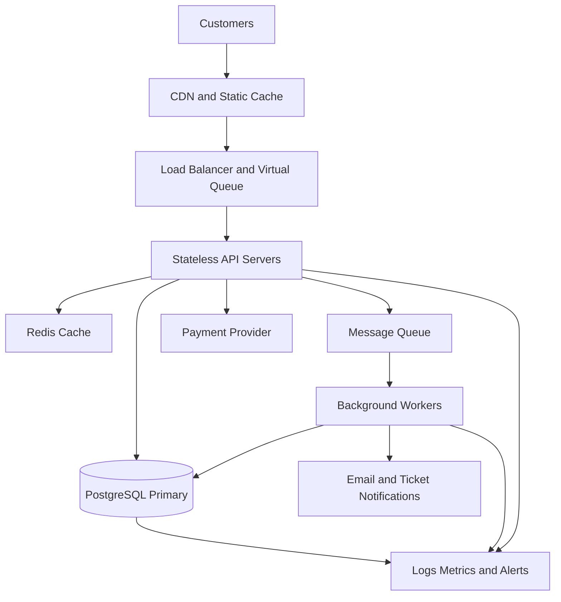

# TicketHub: Ticketing Website System Design

## 1. Requirements

### Functional requirements

TicketHub sells tickets for concerts and other events. The system must allow users to:
- Register, sign in, and manage their accounts.
- Browse, search, and view upcoming events.
- View event details, ticket prices, and seat availability.
- Temporarily hold available seats while completing checkout.
- Pay for orders and receive confirmation.
- View their purchased tickets and order history.
- Cancel or release expired holds according to the booking rules.

Administrators must be able to create events, configure seating and prices, and monitor sales.

### Non-functional requirements

- **Speed:** Event pages and seat maps should load quickly. Caching can speed up browsing, while checkout must verify availability against the authoritative database.
- **Correctness:** A seat must never be sold to two customers for the same event. Payment and order status must remain consistent.
- **Fairness:** Customers should receive clear, consistent rules for seat holds and checkout. Holds must expire after a defined period so abandoned checkouts do not block other customers indefinitely. Rate limits and a virtual queue can help manage high demand.
- **Availability:** The website should remain usable during failures and heavy traffic. Failed payments must not incorrectly produce confirmed tickets.
- **Security:** Use authentication, authorization, encrypted connections, input validation, rate limiting, and a trusted payment provider. Do not store raw payment-card details.
- **Scalability:** Application servers should be able to scale horizontally as demand increases.
- **Observability:** Monitor errors, response times, payment failures, database contention, and remaining ticket inventory.

## 2. Traffic Estimates

### Normal traffic

TicketHub has 2 million registered users. On a normal day, 50,000 people visit and each views 10 pages.

- Daily page views = 50,000 × 10 = 500,000.
- Average page views per second = 500,000 ÷ 86,400 ≈ 5.8.
- Normal daily ticket sales = 5,000.

The 5.8 requests per second figure estimates page views, not every request made by the website. Images, scripts, API calls, and other resources can increase total request volume.

### Popular concert sale

During a popular sale, 200,000 people try to buy 20,000 seats within 10 minutes.

- Average purchase attempts per second = 200,000 ÷ 600 ≈ 333.
- Demand per seat = 200,000 ÷ 20,000 = 10 people per seat.
- At most 20,000 seats can be sold, assuming all seats are available and each person seeks one seat.

The sale produces about 333 purchase attempts per second on average, compared with approximately 5.8 page views per second during normal traffic. These figures describe different operations, so they are not a direct like-for-like comparison. The sale also creates a much greater risk of many users competing for the same inventory.

Actual peak traffic may exceed these averages. TicketHub should load-test for bursts, queue excess demand, cache read-heavy pages, and protect the database from excessive simultaneous checkout requests.

## 3. API Design

The API uses JSON over HTTPS. Protected endpoints require authentication. Examples below show the main request and response shapes.

### Endpoint 1: Browse events

`GET /api/events?search=concert&page=1`

Returns a paginated list of upcoming events.

Example response:

```json
{
  "events": [
    {
      "id": 42,
      "name": "Summer Concert",
      "date": "2027-01-15",
      "venue": "City Arena"
    }
  ],
  "page": 1
}
```

### Endpoint 2: View an event's seats

`GET /api/events/42/seats`

Returns seat identifiers, prices, and availability. The response is informational; the server must recheck availability when a seat is held.

Example response:

```json
{
  "event_id": 42,
  "seats": [
    {"id": 501, "price": 50, "status": "AVAILABLE"},
    {"id": 502, "price": 50, "status": "HELD"}
  ]
}
```

### Endpoint 3: Hold seats

`POST /api/orders/holds`

Requires authentication. The server attempts to reserve the requested seats for a short period, such as five minutes.

Example request:

```json
{
  "event_id": 42,
  "seat_ids": [501]
}
```

Example success response:

```json
{
  "order_id": 9001,
  "status": "HELD",
  "expires_at": "2027-01-15T12:05:00Z"
}
```

If a seat is no longer available, the server returns `409 Conflict`. The client must not assume a seat is reserved until the server confirms the hold.

### Endpoint 4: Pay for an order

`POST /api/orders/9001/payments`

Requires authentication and a valid, unexpired order hold. The request contains a payment-provider token and an idempotency key so that retrying the same request does not create duplicate charges.

Example request:

```json
{
  "payment_token": "provider-token",
  "idempotency_key": "payment-9001-attempt-1"
}
```

The server coordinates with the payment provider and confirms the order only after verified payment success. The response can be `PROCESSING`, `PAID`, or a suitable error. A failed or expired checkout must not issue tickets.

### Endpoint 5: View an order

`GET /api/orders/9001`

Returns the authenticated user's order status, items, total, and relevant timestamps. Users cannot view another customer's private order.

### Endpoint 6: View my tickets

`GET /api/me/tickets`

Returns tickets belonging to the authenticated user, including event information, seat details, and ticket identifiers.

Common error responses include `400 Bad Request` for invalid input, `401 Unauthorized` for missing authentication, `403 Forbidden` for insufficient permissions, `404 Not Found` for missing resources, `409 Conflict` for unavailable seats, and `429 Too Many Requests` when rate limits are exceeded.

## 4. Data Model

A relational database such as PostgreSQL is suitable because ticket inventory and order state require strong consistency.

### Core tables

**users**
- `id` — primary key.
- `name`
- `email` — unique.
- `password_hash`
- `created_at`

**events**
- `id` — primary key.
- `name`
- `description`
- `venue`
- `starts_at`
- `status`

**seats**
- `id` — primary key.
- `event_id` — foreign key to events.
- `seat_label` — for example, A12.
- `price`
- `status` — AVAILABLE, HELD, or SOLD.
- `hold_expires_at` — nullable timestamp.
- `held_by_order_id` — nullable foreign key to orders.

A unique constraint on `(event_id, seat_label)` prevents the same seat label from being created twice for one event.

**orders**
- `id` — primary key.
- `user_id` — foreign key to users.
- `status` — HELD, PAYMENT_PENDING, PAID, EXPIRED, or CANCELLED.
- `total_amount`
- `created_at`
- `hold_expires_at`

**order_items**
- `id` — primary key.
- `order_id` — foreign key to orders.
- `seat_id` — foreign key to seats.
- `price_at_purchase`

A unique constraint on `seat_id` in order_items prevents a seat from appearing in multiple orders under this model. If resale or historical ticket transfers are supported, the model must instead enforce uniqueness for active ownership or active sales using an appropriate database constraint.

**payments**
- `id` — primary key.
- `order_id` — foreign key to orders.
- `provider_reference` — unique payment-provider reference.
- `amount`
- `status`
- `created_at`

### Relationships

- One user can create many orders.
- One event has many seats.
- One order contains one or more order items.
- Each order item refers to a seat.
- An order can have multiple payment attempts, but each provider transaction must be recorded and processed idempotently.

Foreign keys maintain referential integrity. Unique constraints protect important business rules even if application code has a bug.

## 5. Preventing Double-Booking

The most important rule is that checking availability and claiming a seat must be an atomic operation. A simple read followed by a later write is unsafe: two requests might both read AVAILABLE before either updates the row.

TicketHub uses a database transaction, row-level locking, and conditional updates.

### How a seat hold works

1. The customer requests a seat hold.
2. The server begins a database transaction.
3. It locks the requested seat rows using `SELECT ... FOR UPDATE`, in a consistent order when multiple seats are requested.
4. It checks that each seat is available or that any previous hold has expired and can safely be reclaimed.
5. It creates the order and order items, updates the seat status to HELD, and records the hold expiration time.
6. It commits the transaction. If a seat is unavailable, it rolls back and returns a conflict response.

Illustrative SQL for claiming an available seat:

```sql
UPDATE seats
SET status = 'HELD',
    hold_expires_at = NOW() + INTERVAL '5 minutes'
WHERE id = 501
  AND event_id = 42
  AND status = 'AVAILABLE';
```

The application must check the number of affected rows. Exactly one row means the seat was claimed by this update; zero means the claim failed. In production, the order association and all related changes must be made in the same transaction. Expired holds must be reclaimed with a safe, conditional transaction rather than a separate unchecked read.

### What happens when two customers compete?

Suppose customers A and B request seat 501 simultaneously. A obtains the row lock first and changes the seat to HELD. B must wait for the lock. When B continues, the database state no longer satisfies the availability condition, so B cannot claim the seat. B receives a conflict response and can choose another seat.

The database is the authority; a cached seat map is never enough to confirm a booking.

### Payment and hold expiration

Payment processing introduces another challenge because an external payment provider cannot participate in the database transaction. TicketHub should use idempotency keys, a durable payment state, verified provider callbacks, and reconciliation for uncertain outcomes.

Before finalizing a purchase, the server must verify that the order still owns the seats and that the hold is valid under the defined checkout policy. It must transition the order and seats consistently. Expiration workers should reclaim only holds that are still expired and have not been finalized. Payment failures must release inventory safely; uncertain payment outcomes must be reconciled before releasing seats in a way that could cause an already-paid order to lose them.

Database constraints provide a final safeguard against duplicate active seat allocations.

## 6. Architecture Diagram



### Component explanations

- **Customers:** Browse events, choose seats, and complete checkout.
- **CDN and static cache:** Serve images, scripts, and public event content near users, reducing load on the application.
- **Load balancer:** Distributes requests across healthy API servers.
- **Virtual queue:** Limits the number of customers entering the purchase flow simultaneously and communicates waiting status fairly.
- **Stateless API servers:** Authenticate requests, enforce business rules, and can scale horizontally.
- **Redis cache:** Speeds up public event information and temporary non-authoritative data. It must not replace database locking for seat allocation.
- **PostgreSQL primary:** Stores authoritative inventory, orders, and payment records with transactions and constraints.
- **Payment provider:** Processes payments securely outside the database transaction.
- **Message queue and background workers:** Handle notifications, expired holds, reconciliation, and other tasks that do not need to block the customer's request.
- **Monitoring:** Collects logs, metrics, alerts, latency, errors, and database contention so operators can respond to incidents.

### Surviving the big sale

TicketHub should cache public event data, autoscale API servers, queue customers during peak demand, rate-limit abusive traffic, and cap concurrent checkout work to protect the database. Requests for the same seat are serialized by database locks and constraints. Queueing reduces overload, but it does not guarantee that every customer gets a ticket. Inventory must never exceed the number of available seats.

The system should be load-tested before major sales and have database backups, health checks, retry limits, and operational dashboards.

## 7. Trade-offs

### Trade-off 1: Strong consistency versus performance

Using database transactions and row locks protects seat correctness but can increase waiting time when many customers request the same seats. TicketHub accepts this cost for inventory changes and uses caching only for read-heavy information. Correctness is more important than making an unsafe booking appear faster.

### Trade-off 2: Virtual queue versus immediate access

A queue smooths demand and helps prevent overload, but some users must wait and the checkout process feels less immediate. TicketHub uses a queue for high-demand sales while allowing normal browsing when capacity permits. Clear status updates and consistent admission rules help make the queue fair.

### Trade-off 3: Short holds versus checkout flexibility

Short holds return abandoned seats to inventory quickly, but customers with slow connections or delayed payment may lose their opportunity. Longer holds improve convenience but leave seats unavailable for longer. A limited hold duration, clear countdown, and careful handling of uncertain payment results balance these concerns.

### Trade-off 4: Modular services versus operational simplicity

Separate services and queues can scale independently, but they add deployment and monitoring complexity. Starting with a modular application and a reliable relational database is simpler; components can be separated later when measured demand justifies the added complexity.

## 8. Conclusion

TicketHub must support normal browsing and large, competitive ticket sales without selling the same seat twice. Traffic estimates guide caching, queueing, capacity planning, and load testing. A clear API and relational data model support the customer journey, while database transactions, row-level locks, conditional updates, and constraints protect inventory correctness. A virtual queue and horizontally scalable application servers help absorb peak demand, and monitoring supports reliable operations. The main design principle is that customer-facing speed and fairness must never override the authoritative rules that prevent overselling.
